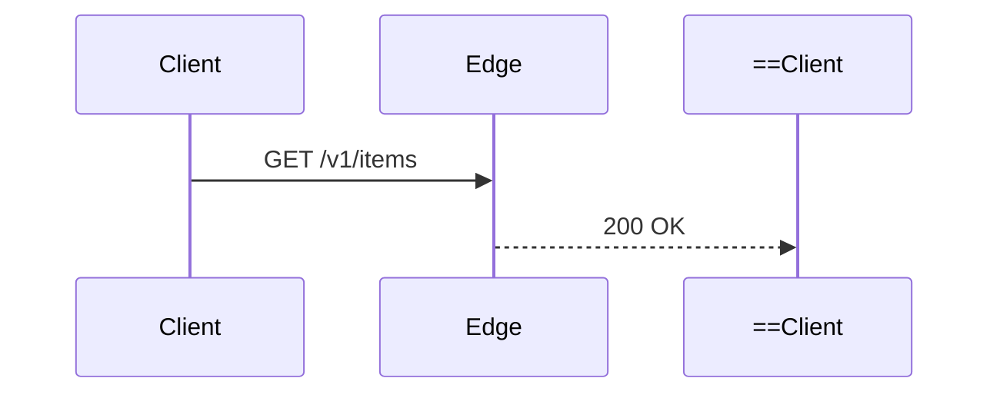

# Scenario: pele

## Context

A project directory with two files under `docs/`:

- `docs/architecture.md` — a Markdown architecture document containing two ``` ```mermaid ``` fenced blocks with syntax errors:
  1. A `flowchart LR` block with unquoted parentheses inside a rectangular node label (`Edge[Ingress Gateway (TLS 1.3)]`).
  2. A `sequenceDiagram` block with an invalid arrow token (`Edge-->>==Client: 200 OK`).
- `docs/untrusted-flow.mmd` — a user-submitted Mermaid diagram containing an external `click` link (`click Sub "https://attacker.example/beacon" "External Link"`).

No global `mmdc` (`@mermaid-js/mermaid-cli`) or headless browser is installed. `node` and `npm` are available on `PATH`.

### Setup

```bash
mkdir -p /tmp/rt-m1/docs && cd /tmp/rt-m1
git init && git commit --allow-empty -m "init"

cat > docs/architecture.md << 'EOF'
# Edge Routing Architecture

## Request Flow

```mermaid
flowchart LR
  Client([Client]) --> Edge[Ingress Gateway (TLS 1.3)]
  Edge --> Origin[Origin Pool]
```

## Sequence


EOF

cat > docs/untrusted-flow.mmd << 'EOF'
flowchart LR
  Sub[Submitted Node] --> Rev[Review Queue]
  click Sub "https://attacker.example/beacon" "External Link"
EOF

git add -A && git commit -m "seed fixtures"
```

## Task

"1. Validate and fix the broken Mermaid diagrams in `docs/architecture.md`.
2. Render the untrusted user-submitted diagram `docs/untrusted-flow.mmd` into a standalone interactive HTML preview at `docs/preview.html` using Pele (`obsidianmd/pele`), constrained to a 480px max width and hardened against untrusted links and images.
3. Summarize the exact commands you ran and how you verified the files."

## Criteria

- [ ] Agent validates `docs/architecture.md` with `scripts/pele --check` rather than relying on visual inspection alone
- [ ] Agent fixes both Mermaid syntax errors in `docs/architecture.md` and re-runs `--check` until all blocks exit `0`
- [ ] Agent generates `docs/preview.html` using `scripts/pele --html` without installing a headless browser
- [ ] Agent passes `--max-width 480` to constrain the diagram layout
- [ ] Agent passes `--no-links --no-images` so the untrusted `https://attacker.example/beacon` link is stripped from `docs/preview.html`

## Baseline

- Date: 2026-10-17
- Agent: Pi `worker` subagent, `amazon-bedrock/global.anthropic.claude-sonnet-5-5:medium`, fresh context

| Criterion | Result | Observation |
| --- | --- | --- |
| Validates Markdown with `pele --check` | Fail | Checked `which mmdc` (not installed); fixed `docs/architecture.md` by visual inspection only with no parser check |
| Fixes syntax and re-runs `--check` to exit 0 | Fail | Fixed both syntax issues in `docs/architecture.md`, but explicitly noted no Mermaid parser was run to verify |
| Generates `docs/preview.html` via `pele --html` | Fail | Did not create `docs/preview.html`; had no bundled `pele` CLI script |
| Passes `--max-width 480` | Fail | Not rendered |
| Passes `--no-links --no-images` | Fail | Discussed generic "Mermaid strict security level" in prose instead of Pele's `--no-links --no-images` flags |

## With-Skill

- Date: 2026-10-17
- Agent: Pi `worker` subagent, `amazon-bedrock/global.anthropic.claude-sonnet-5-5:medium`, fresh context with `skills/pele/SKILL.md`

| Criterion | Result | Observation |
| --- | --- | --- |
| Validates Markdown with `pele --check` | Pass | Ran `scripts/pele --check docs/architecture.md`, which reported the exact line and column errors |
| Fixes syntax and re-runs `--check` to exit 0 | Pass | Quoted `Edge["Ingress Gateway (TLS 1.3)"]`, fixed `Edge-->>Client: 200 OK`, and re-ran `--check` to confirm `OK ... #1 flowchart` and `OK ... #2 sequence` |
| Generates `docs/preview.html` via `pele --html` | Pass | Ran `scripts/pele --html --title "Untrusted Flow" --max-width 480 --no-links --no-images docs/untrusted-flow.mmd -o docs/preview.html` |
| Passes `--max-width 480` | Pass | Passed `--max-width 480` and verified output width (356px < 480px) via `--json` |
| Passes `--no-links --no-images` | Pass | Passed `--no-links --no-images` and verified `grep -c 'attacker.example' docs/preview.html` returned `0` |

## Analysis

Baseline: 0 of 5 criteria passed. Without the skill and its bundled `scripts/pele` wrapper, the agent looks for `mmdc` (`@mermaid-js/mermaid-cli`), edits `docs/architecture.md` by eye without running a parser check, cannot produce `docs/preview.html`, and falls back to generic Mermaid `securityLevel: 'strict'` advice rather than Pele's option flags.

With-Skill: 5 of 5 criteria passed. With `pele` loaded, the agent immediately uses `scripts/pele --check docs/architecture.md` to validate fenced ``` ```mermaid ``` blocks in place, fixes the reported syntax errors, re-verifies exit code `0`, and renders `docs/preview.html` with `--html --max-width 480 --no-links --no-images`, confirming that the untrusted link was stripped from the SVG output.
